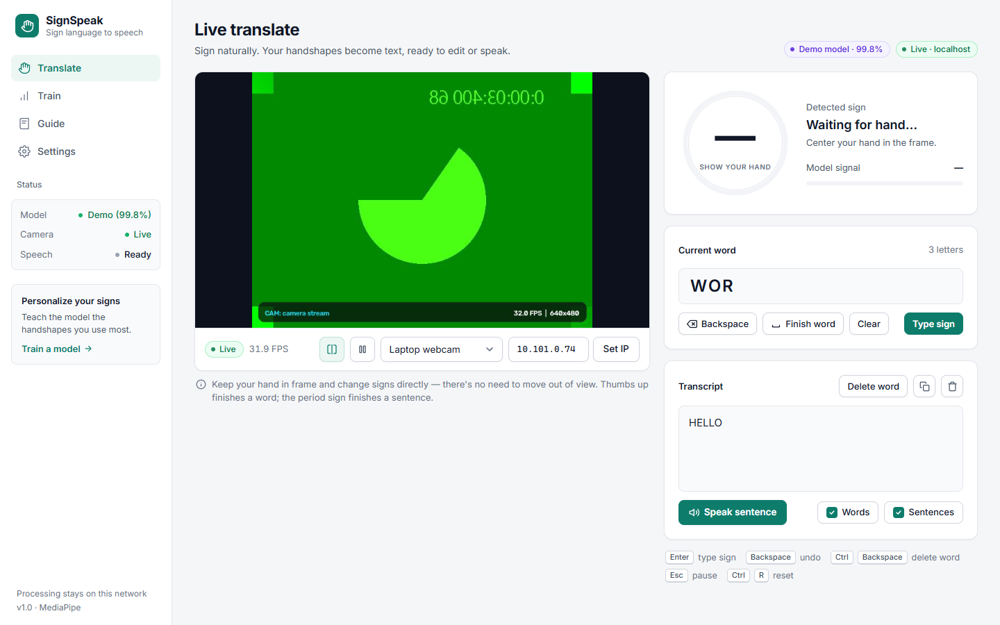
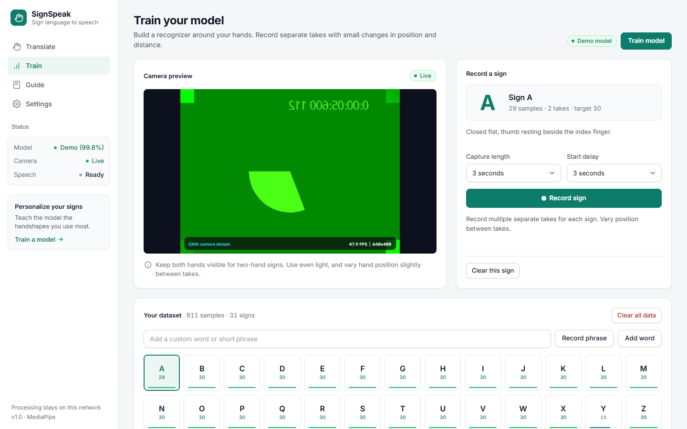
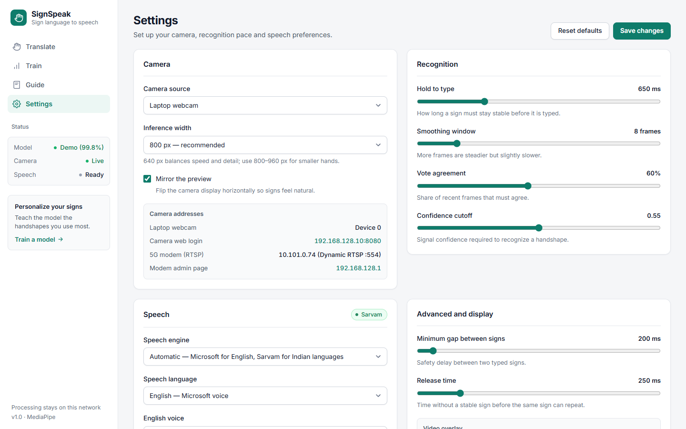

# SignSpeak

**Real-time sign language to text and speech, running at the edge of a private 5G network.**

SignSpeak watches a camera feed, tracks your hands with MediaPipe, recognises the sign you are
holding, types it into a sentence and reads it aloud. It was built for the private 5G lab at
IIIT Dharwad (EC368), where a Sparsh CCTV camera streams over the lab's 5G network to an edge
server that does the recognition. It runs just as well on a laptop with its built-in webcam.

Everything is controlled from a web dashboard that any phone, tablet or PC on the same network
can open. Speech plays through the viewer's own device, in English or in eleven Indian languages.



---

## Contents

- [Features](#features)
- [The demo model](#the-demo-model)
- [Quick start (laptop)](#quick-start-laptop)
- [Using the dashboard](#using-the-dashboard)
- [Training your own signs](#training-your-own-signs)
- [Running in the 5G lab](#running-in-the-5g-lab)
- [Camera and network setup](#camera-and-network-setup)
- [Configuration (`.env`)](#configuration-env)
- [Command-line options](#command-line-options)
- [How it works](#how-it-works)
- [REST API](#rest-api)
- [Project structure](#project-structure)
- [Running the tests](#running-the-tests)
- [Troubleshooting](#troubleshooting)
- [Credits](#credits)

---

## Features

- **Live recognition** of static handshapes from one or two hands, at up to 30 frames a second.
- **Hold-to-type:** a sign is typed only after it has been held steadily (500 ms by default), so
  passing through other handshapes doesn't produce stray letters.
- **Words and sentences:** gestures for *space* (finish the word), *period* (finish the sentence) and
  *backspace*, plus whole-word signs such as HELLO.
- **Speech:**
  - English is spoken by the browser's built-in voices (Microsoft voices in Edge/Chrome on Windows).
  - Hindi, Bengali, Gujarati, Kannada, Malayalam, Marathi, Odia, Punjabi, Tamil and Telugu are
    spoken by [Sarvam](https://www.sarvam.ai/) Bulbul. Signed English is translated into the chosen
    language first.
- **Train your own model** in the browser: record a few takes of each sign, add custom words or
  phrases (type them, or say them and let Sarvam transcribe), and train with one click.
- **Three camera modes:**
  - The laptop's webcam. When the dashboard is opened from another machine, that machine's
    browser streams its own camera to the server.
  - The 5G camera over RTSP.
  - The same camera over direct Ethernet.
- **Video overlay** with the hand skeleton, the detected sign, its confidence and a hold-progress ring.
- **HTTPS by default** (self-signed certificate), which browsers require before they allow camera and
  microphone access from other machines. Plain `http://` links are redirected automatically.
- **Optional desktop app** (Qt) with the same features: `python app.py --desktop`.

---

## The demo model

SignSpeak ships with a ready-to-use **demo model**, [`demo_model.joblib`](demo_model.joblib), so it
works immediately after cloning. It recognises **31 signs**:

| Group | Signs |
|---|---|
| Letters | **A – Z** (ASL fingerspelling) |
| Words | **HELLO**, **NICE TO MEET YOU**, and the Kannada word **ಚೆನ್ನಾಗಿದೆಯಾ** (*chennāgideyā*) |
| Controls | **Space** (thumbs up, finishes a word) and **Backspace** (deletes the last letter) |

It is an Extra Trees classifier (300 trees) trained on 911 samples, with **99.8 %** balanced
accuracy on held-out samples. That figure comes from a sample-level split, so expect lower accuracy
for hands, lighting and camera angles it hasn't seen. Train your own model for best results.

The demo model does **not** include the digits 0–9 or the *period* gesture. You can add them by
training (see below). The training data for the demo model is included in
`data/user_dataset.npz`, so you can extend it rather than start from scratch.

When you train or upload a model it is saved as `data/user_model.joblib` and used instead of the
demo model. Delete that file to go back to the demo model.

---

## Quick start (laptop)

You don't need the 5G lab: any laptop with a webcam works.

**Requirements:** Python 3.10–3.12 (3.12 recommended), and Edge or Chrome.

### Windows

```powershell
git clone https://github.com/Mayur404/SignSpeak.git
cd SignSpeak
.\run.bat
```

The first run creates a `.venv` folder and installs the dependencies (a few minutes). `run.bat`
then prints the address to open, by default **https://localhost:18473**.

### Linux / macOS

```bash
git clone https://github.com/Mayur404/SignSpeak.git
cd SignSpeak
python3 -m venv .venv && .venv/bin/pip install -r requirements.txt
.venv/bin/python app.py
```

On Ubuntu you can instead run `./setup_ubuntu.sh` once and then `./run.sh`.

### First visit

1. Open the address printed in the terminal.
2. The certificate is self-signed, so the browser warns once. Click **Advanced → Proceed**.
3. Choose **Laptop webcam** in the camera menu below the video if it isn't selected already.
4. Click anywhere on the page once. Browsers only allow sound after a click.
5. Hold a sign steadily in front of the camera.

**From your phone:** on the same Wi-Fi, open `https://<your-laptop-ip>:18473`. The transcript and
speech work on the phone too.

> [!NOTE]
> Run only **one** copy of SignSpeak at a time. Windows lets only one program use the webcam. A
> second copy gets a black picture, so SignSpeak refuses to start if its port is already in use.

---

## Using the dashboard

| Page | What it's for |
|---|---|
| **Translate** | Live video, the detected sign, the current word and the transcript. Speak the sentence, copy it, or edit it with the buttons or keyboard. |
| **Train** | Record samples for any sign, add custom words, and train a model. |
| **Guide** | ASL alphabet and numbers reference chart. |
| **Settings** | Camera source and 5G camera IP, recognition timing, speech language and voice, and the video overlay. |

**Keyboard shortcuts** (on the Translate page):

| Key | Action |
|---|---|
| `Enter` | Finish the current word, or type the sign you are holding if the word is empty |
| `Space` / `.` | Finish the word / finish the sentence |
| `Backspace` | Delete the last letter |
| `Ctrl` + `Backspace` | Delete the last word |
| `Esc` | Pause or resume recognition |
| `Ctrl` + `R` | Clear the transcript |
| `A`–`Z`, `0`–`9` | Type that character directly |

**Speech:** under *Settings → Speech*, choose the language. English uses the browser voice, and the
Indian languages use Sarvam, which needs `SARVAM_API_KEY` in `.env`. You can turn automatic
speaking of words, sentences and individual letters on or off.

| Train | Settings |
|---|---|
|  |  |

---

## Training your own signs

1. Open **Train** and pick a sign from the grid. To add a word or phrase, type it in
   *Add a custom word* and click **Add word**. You can also click **Record phrase** and say it;
   Sarvam transcribes it (needs `SARVAM_API_KEY`).
2. Click **Record sign** and hold the sign steadily. After the start delay, SignSpeak captures
   about 3 seconds of hand landmarks.
3. Record **several separate takes** for every sign, moving your hand a little between takes (nearer,
   farther, slightly turned). Aim for 30+ samples from at least 3 takes per sign.
4. Click **Train model**. SignSpeak compares SVM, Extra Trees, Random Forest and k-NN classifiers,
   validates them on held-out takes, and activates the best one. The camera keeps working while it trains.

Use **Save a copy…** to download the model and **Load saved model…** to restore it later.

Only hand landmarks (21 points per hand) are stored, never camera images.

---

## Running in the 5G lab

In the lab, SignSpeak runs on the edge server VM **`172.16.0.11`** (hostname `niralos-video`). That
server sits right behind the 5G core UPF gateway (`172.16.0.7`), so the camera's video crosses the
private 5G air interface before it is processed.

### 1. Set up and start (once per VM)

```bash
ssh user@172.16.0.11
git clone https://github.com/Mayur404/SignSpeak.git && cd SignSpeak
./setup_ubuntu.sh   # installs system packages and a Python virtualenv, creates .env
./start.sh          # runs SignSpeak in the background and prints the URLs to open
```

`start.sh` also works straight after cloning: on first use it runs the setup itself. It opens its
port in `ufw` if it can, and connects to the RTSP camera at `CAMERA_HOST`.

### 2. Open the dashboard

From a laptop or phone on the lab Wi-Fi, open **https://172.16.0.11:18473**.

> [!IMPORTANT]
> Port **8080** on the edge VM is the NiralOS console, not SignSpeak. SignSpeak uses 18473 by
> default. If that port is busy, `start.sh` picks the next free one and prints it.

### 3. Day-to-day

| Task | Command |
|---|---|
| Stop | `./stop.sh` |
| Restart after changing `.env` | `./stop.sh && ./start.sh` |
| Follow the logs | `tail -f signspeak.log` |
| Run in the foreground instead | `./run.sh` |

---

## Camera and network setup

The **Sparsh SC-IM82NP** IP camera is connected to the lab's **5G modem (T99W240)**.

### Why the camera IP changes

Each time the modem or the 5G cell restarts, the 5G core gives the modem a new WAN IPv4 address
(for example `10.101.0.74`). The modem forwards incoming RTSP traffic on port 554 to the camera, so
SignSpeak must be told the modem's current WAN IP.

### Finding the current camera IP

> [!IMPORTANT]
> The modem's admin page (`192.168.128.1`) is **not** reachable over Wi-Fi or 5G. You must connect a
> laptop to the modem with an **Ethernet cable**.

1. Connect an Ethernet cable between your laptop and the modem's LAN port.
2. Give the laptop's Ethernet adapter a static IP: `192.168.128.100`, mask `255.255.255.0`,
   gateway `192.168.128.1`.
3. Open `http://192.168.128.1` and note the **WAN IPv4 Address**.
4. Enter it in the dashboard: type it in the box next to the camera menu and click **Set IP**, or use
   *Settings → Camera*. This also saves it to `CAMERA_HOST` in `.env`. You can edit `.env` directly
   and restart instead.

### Camera stream addresses

| Stream | RTSP URL | Use |
|---|---|---|
| Substream (720p) | `rtsp://admin:admin123@<HOST>:554/avstream/channel=1/stream=1.sdp` | **Recommended**: low latency, light on CPU |
| Main stream (4K) | `rtsp://admin:admin123@<HOST>:554/avstream/channel=1/stream=0.sdp` | Higher resolution, more bandwidth |

Don't use the `/stream1` path: this camera's firmware answers it with `403 Forbidden`.

### Fallback: camera plugged in over Ethernet

With the modem off, the camera can be plugged straight into a laptop (`192.168.128.100`). Its fixed
address is **`192.168.128.10`**, and its web login is `http://192.168.128.10:8080` (`admin` / `admin123`).

- **SignSpeak running on that laptop:** choose **Direct Ethernet** in the camera menu.
- **SignSpeak running on the edge VM:** forward port 554 from the laptop, then select a custom
  stream URL through the API (see `/api/camera` below):
  ```powershell
  netsh interface portproxy add v4tov4 listenport=554 listenaddress=0.0.0.0 connectport=554 connectaddress=192.168.128.10
  ```
  Stream URL: `rtsp://admin:admin123@<LAPTOP_WIFI_IP>:554/avstream/channel=1/stream=1.sdp`

---

## Configuration (`.env`)

Copy `.env.example` to `.env` (the start scripts do this for you) and edit as needed. `.env` is
git-ignored, so your API key stays local. Real environment variables take precedence over `.env`.

| Variable | Default | Meaning |
|---|---|---|
| `WEB_PORT` | `18473` | Port the dashboard listens on |
| `WEB_HOST` | `0.0.0.0` | Address to bind (`127.0.0.1` = this machine only) |
| `WEB_HTTPS` | `1` | `0` serves plain HTTP. The camera and mic then only work on `localhost`. |
| `WEB_SSL_CERT`, `WEB_SSL_KEY` | — | Use your own certificate instead of the generated one in `data/certs/` |
| `CAMERA_HOST` | `10.101.0.74` | Current WAN IP of the 5G modem/camera |
| `CAMERA_SOURCE` | — | Force a camera at startup: `0` (webcam), `browser`, or a full RTSP URL |
| `CAMERA_OPEN_TIMEOUT_MS` | `60000` | How long to wait for the RTSP camera to connect |
| `CAMERA_READ_TIMEOUT_MS` | `20000` | How long a single RTSP read may take |
| `CAMERA_STALL_TIMEOUT_MS` | `30000` | Reconnect after this long without frames |
| `SARVAM_API_KEY` | — | Enables Indian-language speech, translation and voice transcription |

Recognition and speech preferences changed in the dashboard are saved to `data/settings.json`.

---

## Command-line options

```text
python app.py [--host HOST] [--port PORT] [--camera SOURCE] [--http] [--no-browser] [--desktop]
```

| Option | Meaning |
|---|---|
| `--host`, `--port` | Override `WEB_HOST` / `WEB_PORT` |
| `--camera` | Camera to use: webcam index (`0`), `browser`, or an RTSP URL |
| `--http` | Serve plain HTTP instead of HTTPS |
| `--no-browser` | Don't open a browser window on start |
| `--desktop` | Launch the Qt desktop app instead of the web dashboard |

---

## How it works

```text
camera ──► MediaPipe Hand Landmarker ──► features ──► classifier ──► stabiliser ──► composer ──► speech
(RTSP /     21 landmarks × up to 2 hands   normalised   Extra Trees    vote window     words and     browser voice
 webcam /                                  for position, / SVM / RF /  + hold timer    sentences     or Sarvam
 browser)                                  size, angle   k-NN
```

1. **Capture:** a background thread reads the newest frame from the camera, dropping stale frames so
   latency doesn't build up on a slow 5G link.
2. **Hand tracking:** MediaPipe's Hand Landmarker finds up to two hands and returns 21 3-D points per hand.
3. **Features:** each hand is moved to the origin, scaled to a fixed size and rotated upright, which
   makes recognition independent of where the hand is, how far away it is and how the wrist is
   turned. Two hands give a 126-value vector.
4. **Classification:** the model predicts the sign for each frame.
5. **Stabilisation:** a sign must win a majority vote over the last few frames and then be held for
   the *hold to type* time before it is typed. The same sign is not repeated until the hand relaxes
   or changes sign.
6. **Composition and speech:** letters build the current word; *space* finishes it and *period*
   finishes the sentence. Each finished word or sentence is sent to every open dashboard, which
   speaks it.

The server encodes the annotated video as an MJPEG stream. The dashboard polls `/api/status` five
times a second for recognition results.

---

## REST API

All endpoints return JSON unless noted otherwise.

| Endpoint | Method | Description |
|---|---|---|
| `/` | GET | The dashboard |
| `/video_feed` | GET | MJPEG video stream with the overlay |
| `/api/status` | GET | Camera, recognition, text, model and settings. Pass `?since=<event_seq>` to get the typed-sign events after that point. |
| `/api/action` | POST | Text actions: `{"action": "space" \| "period" \| "backspace" \| "delete_word" \| "clear_word" \| "clear" \| "commit_now" \| "type", "param": "A"}` |
| `/api/pause` | POST | Toggle recognition pause |
| `/api/camera` | POST | Switch camera: `{"mode": "laptop" \| "ethernet" \| "5g", "host": "10.101.0.74"}` or `{"source": "<rtsp url>"}` |
| `/api/browser_frame` | POST | One JPEG frame from the viewer's camera (used by *Laptop webcam* on a remote browser) |
| `/api/settings` | POST | Update settings, e.g. `{"hold_ms": 600, "mirror": true}`. Invalid values are rejected as a whole. |
| `/api/system` | GET | Network information (server IPs, camera addresses, port) |
| `/api/dictionary` | GET | All built-in signs with handshape descriptions |
| `/api/dataset` | GET | Recorded samples per sign |
| `/api/dataset/add_word` · `remove_word` · `clear_label` · `clear_all` | POST | Manage custom words and recorded samples |
| `/api/record/start` · `cancel` | POST | Start (`{"label": "A", "duration": 3, "delay": 2}`) or cancel recording |
| `/api/record/status` | GET | Recording progress |
| `/api/train` | POST | Train a model on the recorded dataset |
| `/api/train/status` | GET | Training progress and result |
| `/api/model` | POST | Reload the active model |
| `/api/model/download` | GET | Download the active model (`.joblib`) |
| `/api/model/upload` | POST | Upload a model (multipart `file`). It is checked before it replaces the current one. |
| `/api/tts` | POST | Sarvam speech: `{"text": "...", "language": "hi-IN"}` returns WAV audio |
| `/api/tts/languages` | GET | Supported speech languages |
| `/api/stt/transcribe` | POST | Transcribe recorded audio (multipart `file`) with Sarvam |

---

## Project structure

```text
SignSpeak/
├── app.py                    Entry point: web dashboard (default) or --desktop
├── demo_model.joblib         Ready-to-use demo sign model
├── run.bat · run.sh          Run in the foreground (Windows · Linux/macOS)
├── start.sh · stop.sh        Start/stop in the background on the edge VM
├── setup_ubuntu.sh           One-time setup for Ubuntu (packages, virtualenv, .env)
├── scripts/port.sh           Port selection shared by the shell scripts
├── .env.example              Configuration template (copy to .env)
├── requirements.txt
├── signspeak/
│   ├── vision.py             Camera capture, MediaPipe hand tracking, overlay drawing
│   ├── features.py           Landmark normalisation into feature vectors
│   ├── recognition.py        Model loading, prediction and the hold/vote stabiliser
│   ├── composer.py           Builds words and sentences from typed signs
│   ├── trainer.py            Dataset storage and model training
│   ├── labels.py             Sign names, custom words, handshape hints
│   ├── config.py · paths.py  Settings and file locations
│   ├── sarvam_env.py         Sarvam translation and speech helpers
│   ├── speech_input.py       Sarvam speech-to-text for custom words
│   ├── textdraw.py           Draws Indian-script text on video frames
│   ├── tts.py                Speech for the desktop app
│   ├── web/                  Flask server, streaming engine, HTTPS, dashboard template
│   └── ui/                   Qt desktop app
├── assets/
│   ├── models/hand_landmarker.task   MediaPipe hand tracking model
│   ├── fonts/                Noto fonts for Indian scripts on the video
│   └── asl_alphabet.png      Reference chart
├── data/
│   ├── settings.json         Saved preferences
│   └── user_dataset.npz      Recorded training samples (landmarks only)
├── docs/screenshots/
└── tests/                    Unit and API tests
```

---

## Running the tests

```bash
pip install pytest
python -m pytest tests
```

The tests use temporary files, so they never modify your `.env`, settings or model. They do briefly
open the webcam, so close a running SignSpeak first if you want its video to stay uninterrupted.

---

## Troubleshooting

| Problem | Fix |
|---|---|
| **Webcam picture is black** | Another copy of SignSpeak (or another app) is using the camera. Close the others and run only one copy. |
| **"Port … is already in use"** | A SignSpeak copy is still running: stop it, or set a different `WEB_PORT` in `.env`. |
| **Browser warns about the certificate** | Expected for the self-signed certificate: click **Advanced → Proceed** once. |
| **Laptop camera or mic won't start from another machine** | Browsers require HTTPS for this. Use the `https://` address, and don't start with `--http`. |
| **"Camera not reachable – retrying…"** | The 5G modem's IP has probably changed. Find the new IP (see above) and enter it with **Set IP**. |
| **RTSP returns 403 Forbidden** | Use the `/avstream/channel=1/stream=1.sdp` path, not `/stream1`. |
| **Laggy 5G video** | Use the 720p substream. SignSpeak already uses TCP and always processes the newest frame. |
| **No sound** | Click anywhere on the page once (browsers block audio until you interact). For Indian languages, check `SARVAM_API_KEY`. |
| **Browser shows a NiralOS login page** | You opened port 8080 on the edge VM. Use the port `start.sh` printed (default 18473). |
| **A sign is never typed** | Keep the hand fully in frame and steady, lower *Hold to type* or *Vote agreement* in Settings, or record more samples of that sign and retrain. |

---

## Credits

- Hand tracking: [MediaPipe Hand Landmarker](https://ai.google.dev/edge/mediapipe/solutions/vision/hand_landmarker) (Google).
- Indian-language speech, translation and transcription: [Sarvam AI](https://www.sarvam.ai/).
- The ASL reference material is based on
  [Sign-Language-to-Text-and-Speech](https://github.com/tanmayJivnani/Sign-Language-to-Text-and-Speech)
  (MIT License).

See [THIRD_PARTY_NOTICES.md](THIRD_PARTY_NOTICES.md) for licence details.
